## operaciones basicas con open cv
## Alumno Caleb Dorado NC = 0039
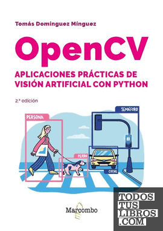
## 1. LECTURA DE IMÁGENES
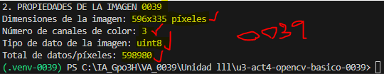

#### CUANDO NO PUEDE CARGAR LA IMAGEN
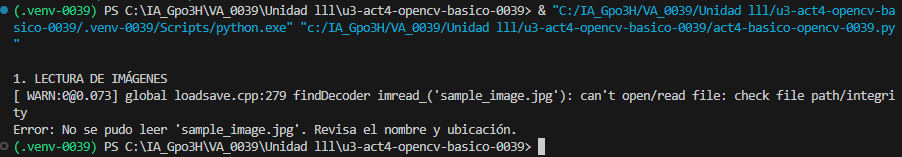
#### CUANDO PUEDE LEER LA IMAGEN
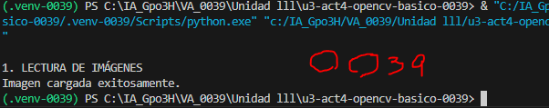
## Imagen original
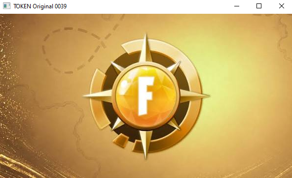
## LA TERMINAL
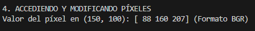
## 4. ACCESO Y MODIFICACIÓN DE PÍXELES INDIVIDUALES
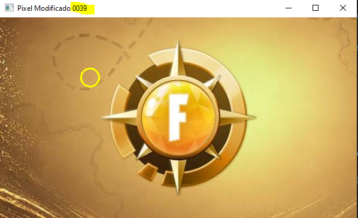
## 5. REGIÓN DE INTERÉS (ROI - REGION OF INTEREST)
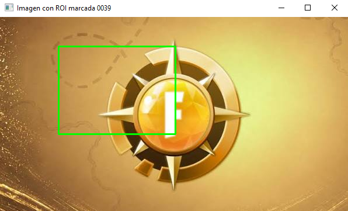
### Region de interes

## 6. SEPARACIÓN Y FUSIÓN DE CANALES DE COLOR (BGR) 0093

### CANAL AZUL
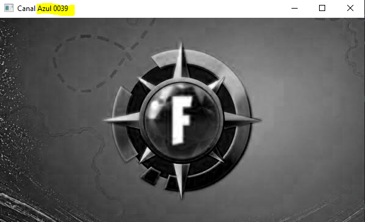
## CANAL ROJO
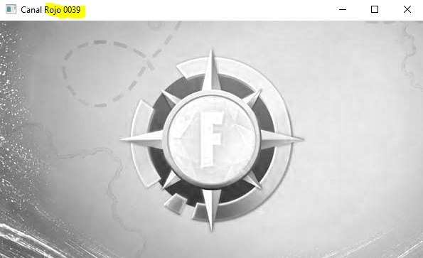
## CANAL VERDE
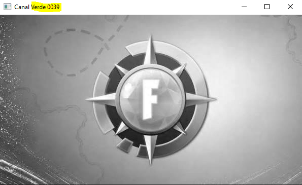
## 6. SEPARACIÓN Y FUSIÓN DE CANALES DE COLOR (BGR) 0093
### CANAL AZUL Coloreado
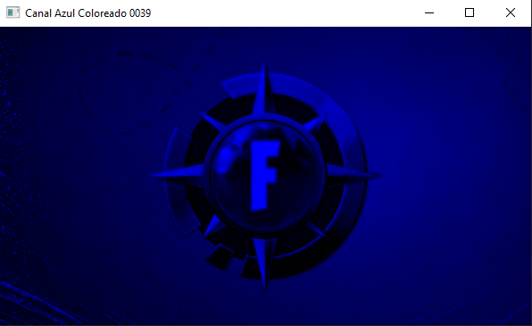
### CANAL ROJO Coloreado
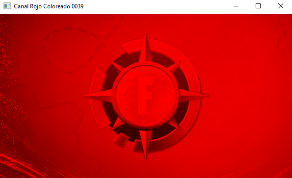
###  CANAL VERDE Coloreado
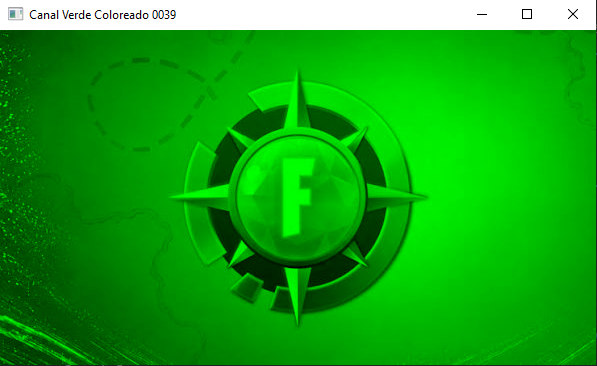
## 7. REDIMENSIONAMIENTO DE IMÁGENES (RESIZING)
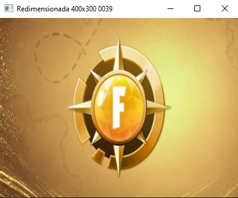
### Mitad de la imagen
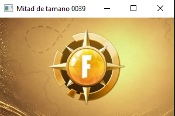
### Imagen Ampliada
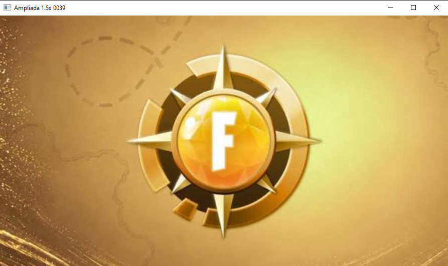
## 8. ROTACIÓN DE IMÁGENES
### A 45 grados
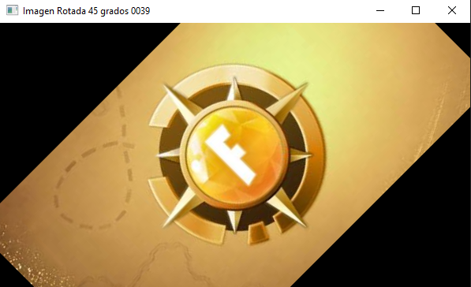
### Volteo Horizontal
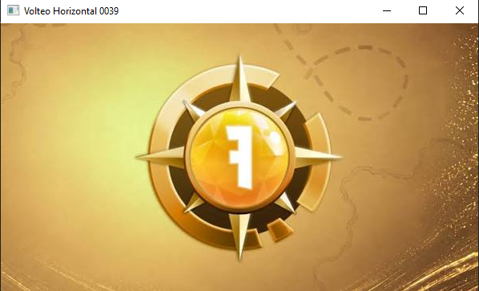
### Volteo Vertical
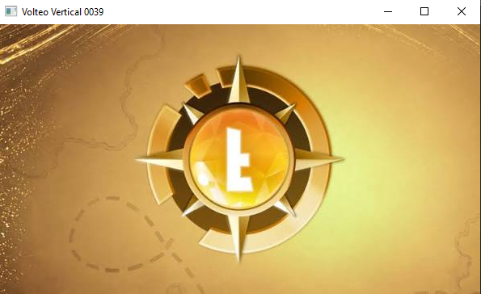
### Volteo Entre Ambos Ejes
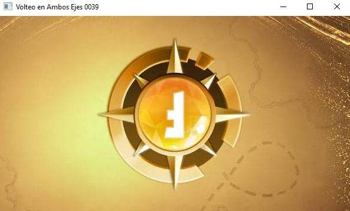
